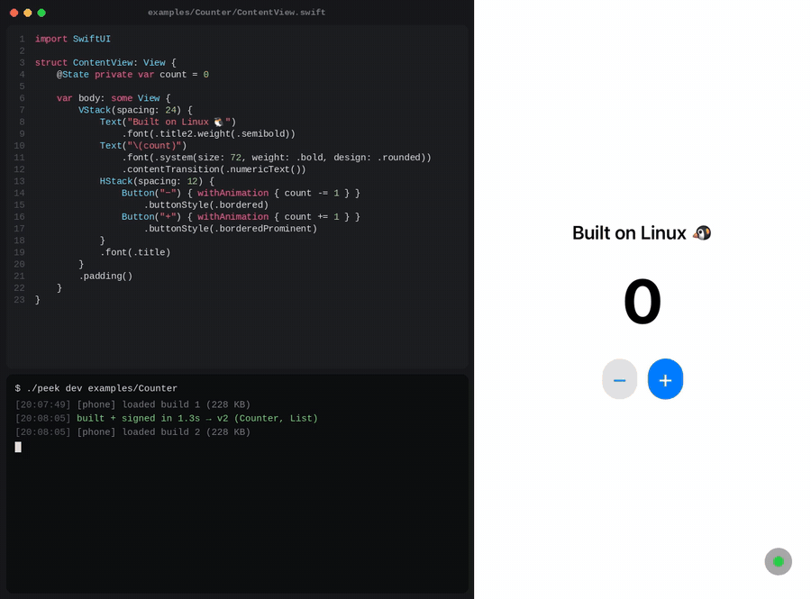

# peek

**SwiftUI previews on a real iPhone, built on Linux. No Mac.**



Save a file, and a second or two later the view on your phone is replaced with
the new one. It is your real code, compiled by the real Swift compiler and
drawn by the real SwiftUI on the device.

- **Fast, and keeps your state.** An edit is on the phone in 1–2 s, and when
  you only change function bodies the running views are patched in place, so
  `@State` survives the reload.
- **Your whole app.** `#Preview` blocks, UIKit views, or the entire `@main`
  App, from a Swift package or an `.xcodeproj`, with package dependencies
  (Swift, C, Objective-C, C++, `.xcframework`), macros, SwiftData, asset
  catalogs and resources.
- **Tests on the device.** `peek test` runs Swift Testing, XCTest and XCUITest
  suites on the iPhone every time you save.
- **Debugging.** `// peek:break` stops at a line and shows values on the phone,
  `// peek:log` prints them, and `--language` shows the app in another language.
- **No Mac, no paid account.** A free Apple ID and SideStore, AltStore or
  LiveContainer is enough.

```
$ peek dev MyApp/
[12:06:52] built + signed in 1.3s → v1 (Counter, List)
```

## How it works

```
 Linux                                         iPhone
 ─────                                         ──────
 *.swift ──swiftc + iOS SDK──▶ preview.dylib
                 │ sign with your dev certificate
                 ▼
            peek dev server ── encrypted HTTP ──▶  Peek app: dlopen() → UIHostingController
```

`peek dev` watches your sources, cross-compiles them into an iOS dynamic
library, signs it with the certificate your sideloading store signed the Peek
app with, and serves it. The Peek app downloads it, `dlopen()`s it and shows
the preview. Package dependencies go into a separate library the phone keeps,
so each reload only carries your own code.

## Requirements

On the Linux machine:

- Swift 6 toolchain and the Darwin Swift SDK, both from
  [xtool](https://github.com/xtool-org/xtool) (`xtool setup`)
- [`ldid`](https://github.com/ProcursusTeam/ldid) and `openssl`
- Python 3.9+

On the iPhone (iOS 17+):

- SideStore or AltStore, or [LiveContainer](https://github.com/LiveContainer/LiveContainer)
  in JIT-less mode. A **free Apple ID** is all it takes: everything in this
  README was tested with one, no paid developer account.
- A way to reach the Linux machine: the same Wi-Fi, the same
  [Tailscale](https://tailscale.com) network, or your own domain (see
  [Connecting the phone](#connecting-the-phone))
- Only for UI tests (XCUITest): [StikDebug](https://github.com/StephenDev0/StikDebug),
  to mount the developer disk image. Previews and unit tests do not need it.

## Quick start

```sh
curl -fsSL https://raw.githubusercontent.com/kimikr/peek/main/scripts/install.sh | sh
peek doctor
peek dev ~/.local/share/peek/examples/Counter
```

On the phone, install `Peek-<version>.ipa` from the [releases](../../releases)
with SideStore or AltStore, or add it to LiveContainer. Use the app and the
`peek` script from the same release.

`peek dev` prints a QR code and a pairing link: scan it with the Camera app or
paste the link into Peek. The first time, tap **Import from SideStore** to hand
over the signing certificate. Inside LiveContainer, export the certificate
LiveContainer is signed with as a `.p12` file and use **Import a .p12 file…**.

Then edit `examples/Counter/ContentView.swift` and save. If something does not
work, `peek doctor` checks the whole setup.

### Connecting the phone

The pairing link lists the addresses the phone tries in turn:

- **Same Wi-Fi.** The server's local address; it also advertises itself with
  Bonjour, so a paired phone finds it again when the address changes.
- **Tailscale.** The server's Tailscale address, from anywhere.
- **Your own domain.** Put a reverse proxy in front of the server and pass its
  address with its port: `peek dev MyApp --host dev.example.com:80`. The server
  then listens on loopback for the proxy, and the phone reaches it over mobile
  data too. Builds and the server's replies are encrypted end to end either way.

`--host` can be given more than once (`--host 100.64.0.5 --host dev.example.com:80`).
`peek link --qr` prints the link again.

### What gets previewed

- Every `#Preview` block (pick one from the green dot menu). `@Previewable`
  works, and a preview may return a SwiftUI view, a `UIViewController` or a
  `UIView`.
- Without any `#Preview`: the `@main` App's first `WindowGroup` (`--app`
  forces this). A `DocumentGroup` opens one new document.
- Or say it explicitly: `peek dev . --root "SettingsView(model: .sample)"`.

### What gets compiled

| You run | peek compiles |
| --- | --- |
| `peek dev File.swift` | just that file |
| `peek dev Folder/` | every `.swift` file under `Folder/Sources` (or `Folder/`) |
| `peek dev Package/` | the app's target, linked against its package dependencies |
| `peek dev App.xcodeproj` | the project's app target (or `--target Name`) |

- **Xcode projects.** Classic groups and Xcode 16 folders, Swift package
  products, local packages and the Debug Swift settings are used. `.xcconfig`
  files, build scripts and extension targets are not. After adding a file to
  the project, restart `peek dev`.
- **Packages.** Dependencies are built once with SwiftPM; the previewed target's
  Swift settings and linker settings are applied.
- **Resources.** Resource bundles, fonts, asset catalogs (compiled to
  `Assets.car`, dark and @1x/@2x/@3x images included) and string catalogs work,
  and so do the asset symbols Xcode generates (`Color(.brand)`, `Image(.logo)`).
  `Image("name")` and `Bundle.main` lookups find your target's resources.
- **SwiftData and `#Predicate`.** peek has its own implementation of SwiftData's
  macros, built once the first time you use them. Each project gets a store of
  its own, which the Peek menu can erase. See `examples/Notes`.

### While previewing

- **Output.** `print()` output shows up in the `peek dev` terminal. When a
  build crashes the app, its last output (or the crash's call stack) is shown
  the next time Peek starts.
- **Screenshots.** `peek shot` saves what the phone shows as a PNG.
- **Display.** The menu switches between light and dark and between text sizes.
- **Language.** `peek dev --language de` shows the app's strings in that
  language (right to left for Arabic and Hebrew). Dates and numbers keep the
  phone's format.
- **Breakpoints.** `// peek:break a, b.count` on its own line stops the app
  there and shows the values and call stack on the phone and in the terminal;
  Continue goes on. `// peek:log a, b` only prints. Use them in actions and
  functions rather than in a view's `body`. See `examples/Breakpoints`.
- **Errors.** A compile error is shown over the last preview that worked.

### Running tests on the phone

```sh
peek test path/to/Package
peek test --once --junit results.xml   # once, exit with the result (CI)
```

runs the Swift Testing and XCTest tests inside the Peek app with the real UIKit
and SwiftUI, again on every save. Results appear in the terminal like
`swift test` prints them. `--filter REGEX` picks tests.

**UI tests (XCUITest)** run unchanged: taps, typing, gestures, rotation,
system alerts, `launchArguments` and `launchEnvironment`, and other apps such
as Settings. See `examples/Calculator/Tests/CalcTests/TallyUITests.swift`.
They need Developer Mode, the developer disk image (mount it with
[StikDebug](https://github.com/StephenDev0/StikDebug)) and your passcode for
each run. The app runs in Peek's process, so state survives `launch()` and
`terminate()`.

## Limitations

- **Edits that change the shape of your types** (stored properties, new types,
  signatures) reload the build, and `@State` starts fresh.
- **The preview runs inside the Peek app**, so its `UserDefaults`, keychain,
  URL schemes, extensions and entitlements (push, iCloud, App Groups, …) are
  Peek's, and permission prompts show Peek's texts.
- **Asset catalogs:** PDF images, data sets and stickers are not compiled. A
  dependency with a string catalog cannot be built on Linux.

## Development

```sh
python3 -m unittest discover tests     # tests
(cd tools && swift test)               # SwiftData macro expansions
./peek build examples/Weather          # compile once, print errors
scripts/release-ipa.sh                 # unsigned IPA for a release
```

## License

MIT
